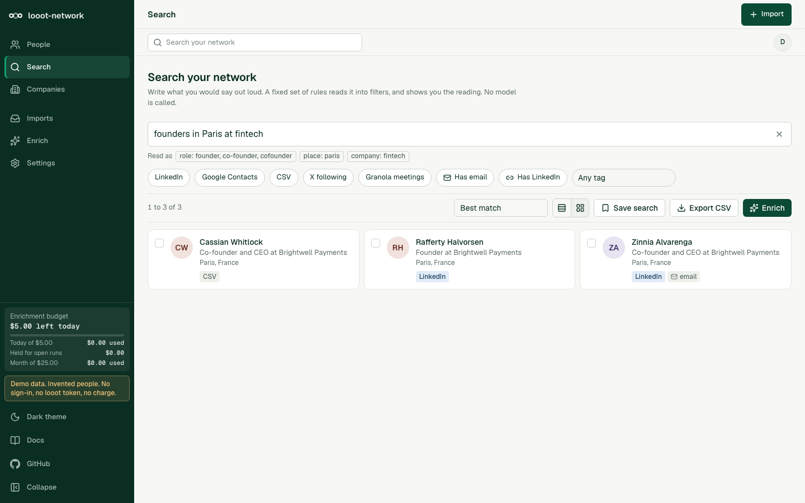

# looot network

[](LICENSE) [](https://github.com/loootai/looot-network/releases) [](https://docs.looot.ai)

Search your own network in plain language. You export your connections from LinkedIn, Google Contacts or X (or bring any CSV), or pull in the people from your Granola meetings, import them, and ask for "founders in Paris at fintech" or "who works at Stripe". The people live in your own Supabase project. Optional paid enrichment goes through [looot](https://looot.ai) and shows its price before it runs.

This is an open-source alternative to [Happenstance](https://happenstance.ai). On 2026-10-12 its pricing page listed Free at $0, Pro at $24 a month billed yearly, and Team at $24 per seat a month. This project has no plan and no seat. You host it, and you pay looot only for the enrichment calls you choose to run. This project is built on looot. It is not the looot dashboard, and it has no connection to Happenstance.

## What it covers and what it drops

Happenstance describes natural-language people search over your accounts, a ranked map of who you know, search across friends' networks, warm-intro drafts, an API and MCP server, and privacy controls. Here is how that maps.

| Happenstance feature | Here |
|---|---|
| Describe the person you want, get matches in your network | Yes. A rule-based parser (no model) plus full-text and fuzzy search |
| Network built from connected accounts | Partly. You import files you exported. Nothing connects to your accounts |
| Ranking by how well you know someone | No. There is no interaction data in an export |
| Search your friends' and groups' networks | No. One owner per network |
| Mutual connection and intro drafts | No |
| Export people to CSV | Yes, from any filtered list |
| API, MCP, CLI | A CLI with `--dry-run`, JSON/CSV/markdown reports, and a Claude Code skill. No MCP server |
| Data not used to train models | Your data stays in your Supabase project. This app calls no model |

Also dropped: semantic (vector) search. It needs an embedding source, and every option needs a new account or key. The search here is full-text plus trigram fuzzy match on name, company, title and place.

## What you need

- Node 20.9 or newer (Next.js 16 requires it). The tests, lint, typecheck, build and demo were run on Node 24.
- For the demo, nothing else. No account, no token.
- For your own data in the web app, a free Supabase project.
- For the CLI, nothing but your exported files.
- For paid enrichment only, a [looot](https://looot.ai) account, an agent token with the scopes `runs.execute`, `catalog.read`, `runs.read` and `usage.read`, and a funded balance (top up from $5; signing up adds no credit). Get a token with `npm i -g looot` then `looot login`, or in looot Settings under "Agent tokens". See https://docs.looot.ai/get-started/sign-in.

## Try it in one minute

```bash
git clone https://github.com/loootai/looot-network && cd looot-network && npm install --ignore-scripts && npm run demo
```

Open http://localhost:3277. The demo has no sign-in and shows a "Demo data" badge. It holds 200 invented people (made-up names, made-up companies, addresses on `example.com`), runs from server memory, and resets on restart. Paid lookups show the same quote as the real app, then play a simulated run: the button says "Run (demo, no charge)" and no call is made. The demo refuses to start while `LOOOT_TOKEN` is set, because it has no sign-in. `?theme=dark` sets the theme.

Or skip the browser:

```bash
npm run network -- search "founders in Paris at fintech" --demo
```

## Get your files

You export the files yourself. Nothing here scrapes LinkedIn, logs in to anything, or stores a password.

| Source | How to export | What the file has |
|---|---|---|
| LinkedIn | Settings and privacy, Data privacy, Get a copy of your data. Pick Connections, request the archive, unzip it when LinkedIn emails you. Import `Connections.csv` | Name, profile URL, company, position, connected-on date. Most email addresses are blank because LinkedIn only includes the ones people allow. There is no location |
| Google Contacts | contacts.google.com, select all, Export, Google CSV | Names, emails, phones, organisation, title, city, labels, notes. Gmail contacts are this same list |
| X | Settings, Your account, Download an archive of your data. Import `data/following.js` | Account ids and profile links only. Names stay as placeholders |
| Any CSV | A header row, one person per row | Whatever you map. The Imports page shows a column mapping step before anything is saved |

Example files are in [examples/](examples/). `Connections.csv` starts with a few lines of notes before the header, and the parser skips them.

## How people are matched

Importing is safe to repeat. Two rows are the same person when they share, in this order, a LinkedIn profile URL, an email address, an X link, or a full name plus company (legal suffixes and accents are ignored, so "Stripe, Inc." and "stripe" match). A bare name never merges two people. Matching works inside one file and against everyone already stored. A match fills empty fields and adds emails, phones and tags. It never overwrites a field that has a value. Every file row that fed a person is kept, and the profile drawer shows them.

## Searching

One box, plain language. A fixed set of rules reads the sentence into filters and shows you the reading under the box.

| You write | Read as |
|---|---|
| `founders in Paris at fintech` | role founder (also co-founder), place Paris, company or topic fintech |
| `who works at Stripe` | company Stripe |
| `engineers at Google or Meta in San Francisco` | role engineer, company Google or Meta, place San Francisco |
| `CTOs with email from linkedin` | role CTO, has an email, source LinkedIn |
| `tagged investor-intro`, `#fintech` | tag |
| `named Odile Fenwick` | name |
| `Odille` | free word, matched with typo tolerance |

Different kinds of filter are joined with AND, and several values of one kind with OR. "At fintech" matches a company name or any word in a person's profile text, because an export has no industry field. Free words match the start of a word in the profile text, or a close trigram match on name, company, title and place. Controls next to the box add filters for source, email, LinkedIn URL, tag and company. There is no model in the loop. The parser is in [src/lib/search/parse.ts](src/lib/search/parse.ts) and its tests list what it understands.

In Supabase the work is done by the SQL function `search_people()` (full-text index plus `pg_trgm`). The demo and the CLI run the same rules in memory. `npm run test:sql` loads the 200 demo people into a throwaway Postgres and checks that the function and the in-memory search return the same people for 15 queries.

## Run it with your own data

1. Create a Supabase project. In Authentication, enable Email (magic link). Add `http://localhost:3000/auth/callback` and your deployed URL to the redirect URLs.
2. Apply the four files in [supabase/migrations/](supabase/migrations/) in order, with `supabase db push` or by pasting them into the SQL editor. They create the tables, row-level security, the search functions and the budget functions. Nothing is dropped.
3. Copy the env file and fill it in:

```bash
cp .env.example .env.local
npm install --ignore-scripts
npm run dev
```

4. Open http://localhost:3000, sign in with an email on your allow-list, and use Imports.

| Variable | Needed | What it does |
|---|---|---|
| `NEXT_PUBLIC_SUPABASE_URL` | yes | Supabase project URL |
| `NEXT_PUBLIC_SUPABASE_ANON_KEY` | yes | Supabase anon key. The app uses it with the signed-in user's session only. There is no service role key |
| `LOOOT_NETWORK_ALLOWED_EMAILS` | yes, outside demo | Comma separated emails that may use the network. Case-insensitive, exact match. With this and the domains variable both empty, the app shows a setup page and refuses everything |
| `LOOOT_NETWORK_ALLOWED_DOMAINS` | no | Comma separated email domains that may use it. Exact domain, not a suffix |
| `GRANOLA_API_KEY` | for Granola import | Granola API key (`grn_...`, Business plan). Server only. See the Granola section |
| `LOOOT_NETWORK_ENRICH` | for paid runs | `1` turns paid enrichment on. Off by default |
| `LOOOT_TOKEN` | for paid runs | looot agent token. Server only, never sent to the browser |
| `LOOOT_NETWORK_CAP_USD` | no | Most one run may spend. Default 1. The browser cannot change it |
| `LOOOT_NETWORK_MAX_PEOPLE` | no | Most people one run may cover. Default 200 |
| `SPEND_RATE_LIMIT_PER_MIN` | no | Calls per user per minute to the quote and enrich routes. Default 30 |
| `LOOOT_API_URL` | no | Defaults to `https://api.looot.ai` |
| `NEXT_PUBLIC_DEMO` | no | `1` turns on demo mode. Set by `npm run demo` |
| `LOOOT_OFFLINE` | no | `1` skips the live price read and uses the dated prices |

## Command line

```bash
npm run network -- import Connections.csv contacts.csv
npm run network -- search "founders in Paris at fintech" Connections.csv contacts.csv
npm run network -- enrich Connections.csv --kinds profile,email --max-spend 1 --dry-run
```

Add `--granola` to `import`, `search` or `enrich` to include your Granola meetings (see below). `--since 2026-01-01`, `--exclude-domain mycompany.example.com` and `--self me@mycompany.example.com` narrow it, and `--dry-run` counts what it would add and writes nothing.

Reports go to `./out` as JSON, CSV and markdown (`--out`, `--format`). `--dry-run` prints the list-price cost and makes no call, with or without a token. Exit codes: 0 done, 1 error, 2 refused (no token, over the cap or budget, token rejected). The CLI keeps its budget and stored answers in `.looot-network/budget.json`. Run `npm run network -- --help` for every option.

## Granola meetings

Granola is a meeting-notes app. This imports the people who attended your meetings as contacts with source "granola". Each person keeps the date you last met and the title of that meeting on their profile (the Granola row in the profile drawer), plus how many meetings you shared. They go through the same dedupe and merge as the CSV sources: matched by email, existing details are never overwritten, and importing twice adds nobody.

- What it reads: the list of notes and, for each note, the attendees and calendar invitees. It never asks for transcripts and never reads private notes.
- What you need: a Granola Business plan. API keys are not available on other plans. Create a key in Granola under Settings, Connectors, API keys, and set `GRANOLA_API_KEY` on the server (`.env.local`, or `export` for the CLI). The key is read on the server only. The browser never sees it, and the request body cannot carry one.
- Web app: Imports, "Check Granola" counts what would change, then "Import". The route is `POST /api/import/granola` and sits behind the same allow-list as the other import routes.
- CLI: `GRANOLA_API_KEY=grn_... npm run network -- import --granola --dry-run`, then again without `--dry-run`. Without a key it exits 2 and says so.
- Limits: one list call per 30 notes plus one request per note, 200 notes by default, so a first import takes a while. Calendar invitees carry no name, so those people get a name made from the email until another source supplies one.
- Demo mode shows the source with invented meetings and no key.

**Not tested against a live Granola account.** No Business-plan key was available. Two response shapes were guessed: the sample list response (the docs show none, so the fixtures follow the documented schema) and the `Retry-After` header on a 429 (undocumented, so the client falls back to waiting 0.5, 1 and 2 seconds). All HTTP in the tests is mocked. If a real response differs, `src/lib/import/granola/types.ts` and its fixtures are where to look.

The `skills/looot-meeting-prep/` skill is separate: it prepares a brief for an upcoming meeting from a Granola note and enriches the attendees through looot after showing a quote.

## Enrichment (optional, paid, off by default)

Enrichment fills in what an export leaves out: a person's current company, title and place from their LinkedIn profile, company details, and a work email. It runs three looot calls, each pinned to one endpoint so the price you see is the price charged. Prices below were read from the public catalog on 2026-10-12.

| Lookup | looot job | Endpoint | List price | Needs |
|---|---|---|---|---|
| LinkedIn profile: title, company, place | `linkedin.person.profile` | `anyapi-run-linkedin-profile-thin` | $0.0012 per call | a LinkedIn URL |
| Company firmographics | `company.enrich` | `thecompaniesapi-companies-by-email` | $0.0019 per call | a work email or company domain |
| Work email from the profile | `people.email.find` | `anysite-api-linkedin-user-email` | $0.003598 per call | a LinkedIn URL, and no email yet |

Typical run at list price. 100 people who all have a LinkedIn URL and no email: profiles $0.12, work emails $0.3598, so $0.4798 for both. Company details cost $0.0019 per distinct domain, and one call serves everyone at that domain. A Connections.csv has no domains, so company lookups only apply to people with a work email or a domain from another file. A failed call costs nothing. Prices and the catalog can change: the quote reads live prices, and falls back to these dated ones with a warning.

Money rules:

- The quote is shown before any call, per lookup, with the people who are left out and why.
- Each run has a cap that comes from the server environment, never from the request.
- Each call reserves its list price against a daily and a monthly budget (defaults $5 and $25, saved in Settings). The reservation is one locked database transaction, so two runs started together cannot both pass.
- Every call carries a stable idempotency key. Profile and email calls are keyed per person. The company call is keyed per domain, because the answer depends only on the domain. The same key replays the stored run and never charges twice.
- A call still running when waiting stops is "pending". Its money stays reserved, it is never written as failed at $0, and running the same lookup later collects it with no second charge.
- A refusal from looot (bad token, no balance) gives the reservation back and stops the run. A network error with no answer keeps the reservation, because the request may have reached looot.

What is not verified: no paid looot run was made while building this, so the parsers for the three response shapes were written from the catalog descriptions and are marked "not yet checked against a live call" on the Enrich page. If a field comes back in another shape it is left empty, never guessed.

## Securing a deployment

Outside demo mode every page and every API route needs a signed-in user whose email is on `LOOOT_NETWORK_ALLOWED_EMAILS` (or whose domain is on `LOOOT_NETWORK_ALLOWED_DOMAINS`). An unlisted path is private.

- **Public:** `/login`, `/setup`, `/not-authorised`, `/auth/callback` (the Supabase sign-in landing) and `/api/health`. Nothing else. The health check returns `{"ok":true}` and nothing about the data.
- **Admin, everything else:** the pages (People, Search, Companies, Imports, Enrich, Settings) and the API routes (people, import, export, saved searches, companies, quote, enrich, budget, enrichments). Each page and route checks the session itself, in addition to the proxy.
- **No allow-list set:** the app shows a setup page and every data, settings and spending route answers 503.
- **Row-level security:** every table is scoped to the signed-in owner and forced, and anonymous callers get nothing. `npm run test:sql` checks this on a throwaway Postgres.
- **State-changing requests** must come from the same origin and carry JSON. A cross-site form or fetch is refused with 403, even with a valid session.
- **Money:** the per-run cap, the people limit and the budgets come from server config or the owner's saved settings. A request body cannot set them, and the spending routes are rate limited per user.
- **Exports** and every route that returns personal data send `Cache-Control: no-store`. Security headers (CSP, frame denial, no sniffing, no referrer) are set on every path in [next.config.mjs](next.config.mjs).
- **Demo mode** has no sign-in and refuses to start next to a `LOOOT_TOKEN` or a real Supabase URL.
- **Stronger option:** put the app behind a VPN or an identity-aware proxy as well. The allow-list only decides who may use the app. It does not hide the host.

A test generated from the file tree fails when a route or page is added without a session check.

## Privacy

Your people live in your own Supabase project. This app has no database of its own and calls no model. It sends nothing to looot unless you run a paid lookup, and then only the LinkedIn URL or company domain that lookup needs. Removing a person deletes their row and the file rows behind them. You are responsible for having the right to hold and search the contacts you import.

## Install for agents

Clone the repo, run `npm install --ignore-scripts`, and copy `skills/looot-network/` (and, for meeting prep, `skills/looot-meeting-prep/`) into `~/.claude/skills/` for Claude Code. The skill runs the CLI: import, search, then a `--dry-run` quote before any paid run. [llms.txt](llms.txt) has the same for other agents.

## Checks

```bash
npm run typecheck && npm run lint && npm test && npm run build
npm run test:sql      # needs Postgres tools on PATH (brew install postgresql@17). No Docker.
npm run test:gate     # after a non-demo build: starts the app next to a fake local auth server and checks with real requests that admin routes are closed without a session
npm run leak-scan
```

## Status

Version 0.1.1. What was run: unit tests with mocked HTTP for the parsers, dedupe, query parser, enrichment engine, budget and CLI; route-level gate tests; the SQL checks on PostgreSQL 17; a clean build; the demo on every route. What was not run: any call to Granola (all mocked, no Business-plan key), any paid looot call, the Supabase client code against a live Supabase project (the SQL was checked on plain Postgres and the client with a recording stand-in), and the sign-in email flow. Not built: scheduled refresh, background jobs, vector search, a shared team network.

## Licence

MIT, copyright looot. See [LICENSE](LICENSE).
